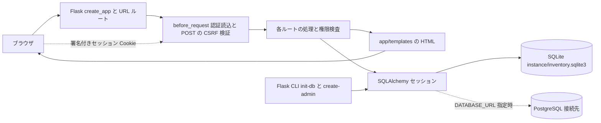
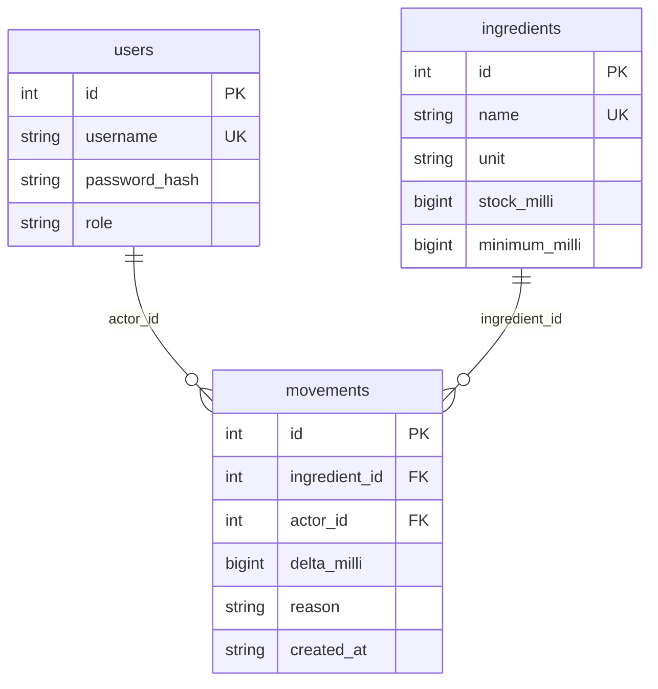
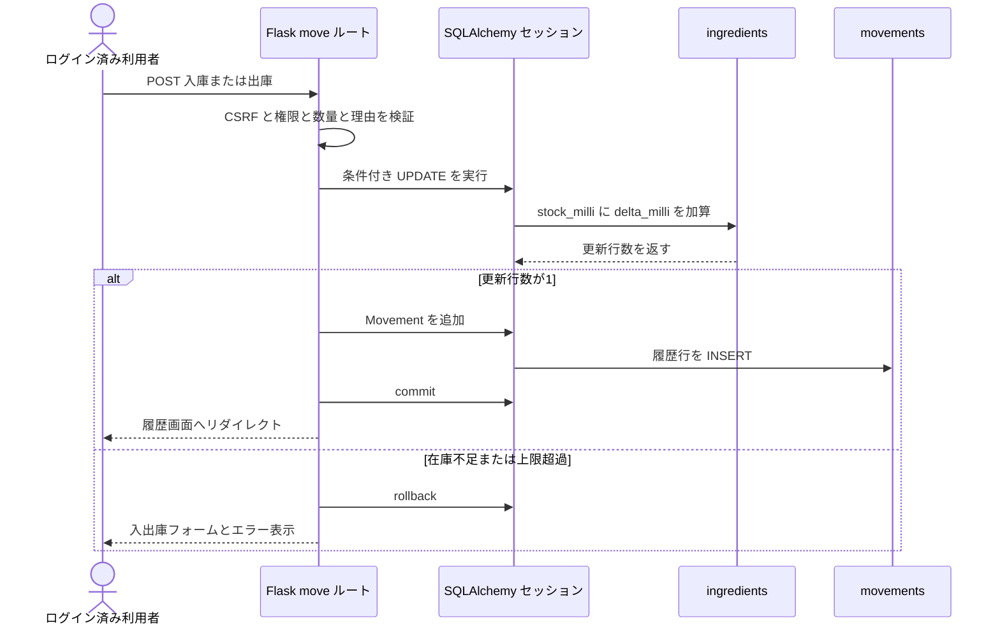
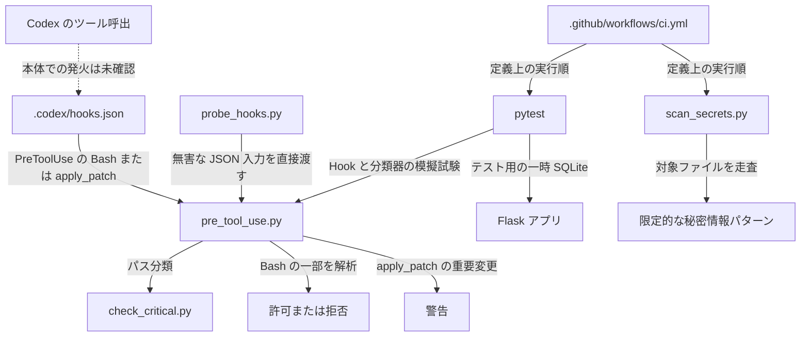

# 現行アーキテクチャとデータフロー

確認対象: このリポジトリの `app/__init__.py`、`app/templates/`、`.codex/`、`scripts/`、`tests/`、`.github/workflows/ci.yml`、`README.md`（2026-11-04）。添付の「現行構成・データフロー設計書」は、この作業環境では確認できなかったため、以下は実際のソースコードを一次資料として作成した。

## 状態の区別

| 状態 | 範囲 |
| --- | --- |
| 実装済み | Flask の画面・認証・権限制御、SQLAlchemy モデルと SQLite の既定接続、入出庫と履歴、CLI 初期化、ローカル Hook 設定・判定器、pytest、秘密情報の限定的パターン検査、GitHub Actions ワークフローファイル |
| 模擬試験済み | `scripts/probe_hooks.py` と `tests/test_policy.py` / `tests/test_hook_safety.py` による、Hook への無害な文字列入力・設定有無の比較。危険操作そのものは実行しない |
| 未実装・未確認 | Codex 本体によるこのプロジェクトの Hook 読込・発火・拒否の実測、GitHub 側の必須検査と承認、Gmail 通知、Render 公開ゲート、Neon 接続、DB マイグレーション・バックアップ、Docker/Compose の稼働確認 |

「実装済み」はコード上の状態を表し、本番稼働や独立した安全性の保証を意味しない。

## 構成と処理経路

既定の `DATABASE_URL` は `sqlite:///` と Flask の instance パスを組み合わせた SQLite ファイルである。`APP_ENV=production` では `postgresql+psycopg://` で始まる接続先と32文字以上の `APP_SECRET_KEY` を要求する。PostgreSQL への実接続や本番利用を確認した図ではない。`Dockerfile` は Gunicorn 起動を定義し、`compose.yaml` は開発用 PostgreSQL コンテナを定義するが、稼働は未確認である。

### URL、権限、テンプレート

| URL・メソッド | 処理 | 権限 | HTML テンプレート |
| --- | --- | --- | --- |
| `GET /health` | `{"status":"ok"}` を返す | 不要 | なし |
| `GET /login`、`POST /login` | ログインフォーム、ユーザー名とパスワード照合 | 不要 | `login.html` |
| `POST /logout` | セッション消去 | ログイン済み | なし。`/login` へリダイレクト |
| `GET /` | 材料一覧と在庫不足表示 | ログイン済み | `index.html` |
| `GET/POST /ingredients/new` | 材料登録、初期在庫0 | admin | `ingredient.html` |
| `GET/POST /ingredients/<int:ingredient_id>/edit` | 名前と最低在庫数の編集。単位は変更しない | admin | `ingredient.html` |
| `GET/POST /ingredients/<int:ingredient_id>/move` | 入庫・出庫と履歴追加 | ログイン済み | `move.html` |
| `GET /ingredients/<int:ingredient_id>/history` | 当該材料の新しい履歴200件 | ログイン済み | `history.html` |
| `GET/POST /users/new` | admin または staff のユーザー作成 | admin | `user.html` |

全画面テンプレートは `base.html` を継承する。`index.html` は `stock_milli <= minimum_milli` を「不足」と表示するため、両者が0でも不足表示になる。テンプレートのリンク表示に加え、ルート側の `login_required` がアクセスを制限する。存在しない材料IDは404、権限不足は403となる。

## SQLite のスキーマ

以下は SQLAlchemy のモデル定義。`flask --app 'app:create_app' init-db` が `Base.metadata.create_all` で新規テーブルを作る。既存表の変更を適用するマイグレーションはない。

`users.role` は `admin` / `staff`、`ingredients.unit` は `g` / `ml` / `個`。在庫と最低在庫は非負、履歴の増減値は0以外という `CHECK` 制約を定義する。数量は小数第3位までを整数の千分単位に変換する。`movements.created_at` は UTC の ISO 形式文字列であり、DB の日時型ではない。外部キーはモデル上で宣言されているが、SQLite の `PRAGMA foreign_keys=ON` はソース内で設定していないため、SQLite 上での外部キー制約の強制は未確認である。

## 認証、セッション、入出庫トランザクション

`create-admin` は対話入力したパスワードを Werkzeug の `pbkdf2:sha256:600000` でハッシュ化する。Webログインは `check_password_hash` で照合し、成功時にセッションを消去して `user_id` と新しい CSRF トークンを格納する。Flask の既定の署名付き Cookie セッションを使用し、サーバー側セッションストアはない。リクエスト開始時に `session["user_id"]` から `users` を引き直す。全 `POST` でフォームの CSRF トークンを比較し、終了時に DB セッションを閉じる。Cookie は HttpOnly、SameSite=Lax、本番モード時のみ Secure。ログアウトはセッションを消去する。

出庫は `stock_milli >= 出庫量`、入庫は `stock_milli <= 上限 - 入庫量` を `UPDATE` 条件に含める。更新と履歴追加は同じ DB セッションの1回の `commit` に含まれる。入力エラーや更新行数不一致では `rollback` する。履歴だけ、または在庫だけを独立してコミットする処理ではない。DB・認証・在庫の基本動作は `tests/test_inventory.py`、`tests/test_auth.py`、`tests/test_secrets.py` で検査する。

## Hooks、検査、CI の経路

`.codex/hooks.json` は `PreToolUse` のツール名 `Bash` と `apply_patch` に `pre_tool_use.py` を割り当てている。Bash 側は `shlex` などで一部のシェル構文を解析し、`git push`、再帰強制削除等を拒否する。解析不能な構文も一部拒否するが、全ツール・全実行経路は網羅しない。`apply_patch` では対象不明・プロジェクト外のパスを拒否し、重要ファイル変更は**警告のみ**である。`PostToolUse` は設定されていない。`probe_hooks.py` は Hook を直接起動して文字列を渡す模擬試験であり、Codex 本体の発火確認ではない。

`scripts/check_critical.py` は Git の追加・変更・削除・改名を読み、分類を JSON で表示し、該当時に終了コード2を返す。ローカルの助言的検査で、現在の `.github/workflows/ci.yml` からは実行されない。ワークフローファイルには `pull_request` と `main` への `push` 時に依存関係導入、`python -m pytest -q`、`python scripts/scan_secrets.py` を順に実行する定義がある。ただし Git remote がなく GitHub 側の実行は未確認で、必須ステータスも未設定である。`tests/conftest.py` は各テストの一時 SQLite DB とダミーの admin / staff を作る。秘密情報検査は設定済みの少数の正規表現を走査し、検出時に終了コード2、未検出時に0を返す。検出対象外の秘密情報が存在しないことまでは証明しない。

## 境界と未実装の連携

Hook と分類器と CI ワークフローはこのリポジトリ内にあり、同じ変更者が編集できる。Hook の警告やローカルテスト結果を公開承認として扱わない。GitHub の保護ルール、AIが変更できない場所の独立検査、重要変更の人間承認、Gmail 通知、Render の公開制御、Neon 本番DB、バックアップと復旧は、設計対象であって現行の稼働経路にはない。
